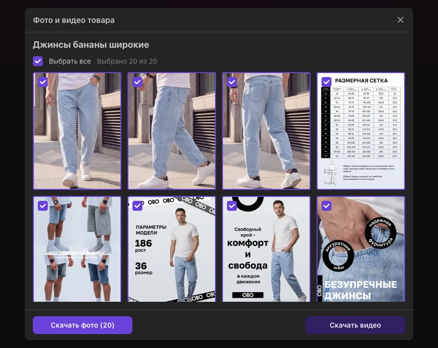

# WB Media Downloader

[](https://github.com/FlameFront-end/wb-media-downloader/actions/workflows/ci.yml)

Приложение для скачивания фото и видео с карточек Wildberries. Введите артикул или вставьте ссылку на товар, чтобы сохранить выбранные фото одним ZIP-архивом или скачать видео в MP4.

**[Открыть приложение](https://wb-media-downloader-omega.vercel.app/)**

**Демо-артикул — `604174866`.** [Смотреть запись демо (MP4)](docs/media/demo.mp4). Ожидание скачивания видео в записи ускорено.

[](docs/media/demo.mp4)

## Запуск

Версия Node.js для разработки указана в [`.nvmrc`](.nvmrc). Команды выполняются из корня репозитория.

```bash
nvm use
npm ci
npm run dev
```

Откройте [localhost:5173](http://localhost:5173/) и введите `604174866`. Для проверки валидации введите `0`, а для экрана «Товар не найден» используйте артикул `1`.

Дополнительные переменные для запуска не нужны. При необходимости адрес списка CDN-хостов можно переопределить через `VITE_WB_UPSTREAMS_URL` в `apps/web/.env.local`. Пример есть в [`.env.example`](apps/web/.env.example).

## Как устроено

- **Карточка.** Приложение находит нужный CDN-хост по артикулу и загружает данные из `card.json`. TanStack Query держит карточку свежей в кэше пять минут, поэтому при повторном открытии этого товара галерея доступна без нового запроса.
- **Фото.** Галерея показывает превью. При скачивании приложение загружает оригиналы выбранных снимков и упаковывает их в ZIP через `fflate`.
- **Видео.** Браузер получает HLS-плейлист. Если плейлист или сегменты отсутствуют, формат не поддерживается или источник превышает лимит размера, приложение пробует следующее качество в порядке 1440p → 1080p → 720p. Сегменты скачиваются по порядку и собираются через `mux.js` в MP4 без перекодирования.
- **Загрузка.** Интерфейс показывает прогресс и позволяет отменить скачивание. Закрытие галереи также отменяет незавершённые загрузки.

Приложение работает без собственного бэкенда: браузер обращается к CDN Wildberries напрямую, а Vite собирает статические файлы в `apps/web/dist`. Интерфейс написан на React и TypeScript с Mantine. Исходники в [`apps/web/src`](apps/web/src) разделены на слои Feature-Sliced Design: `app`, `pages`, `widgets`, `features`, `entities` и `shared`. Границы слоёв проверяет Steiger.

## Проверки

```bash
npm run format:check
npm run lint
npm run lint:arch
npm run typecheck
npm test
npm run build
```

Для браузерных тестов:

```bash
npx playwright install chrome webkit
npm run test:e2e
```

Vitest и MSW проверяют загрузку карточки, обработку ошибок и отмену запросов. Playwright проверяет собранное приложение. В Chrome тест скачивает ZIP, сверяет его содержимое и перематывает скачанный MP4. В WebKit с настройками iPhone тест скачивает оба файла. Тесты подменяют ответы CDN, чтобы их результаты не зависели от доступности Wildberries.

## Деплой

В Vercel укажите корень репозитория и Node.js 22. Команды установки и сборки и путь к статическим файлам заданы в [`vercel.json`](vercel.json). Для ручного деплоя привяжите локальную копию командой `npx vercel link`, затем выполните `npx vercel deploy --prod`.

## Ограничения

Приложение зависит от доступности публичных файлов CDN Wildberries и поддерживает незашифрованные HLS-плейлисты с MPEG-TS-сегментами и непрерывной шкалой времени.

Архив и MP4 собираются в памяти вкладки. Галерея принимает до 200 фото, один фотооригинал или видеосегмент ограничен 32 МиБ, а весь ZIP или MP4 — 128 МиБ исходных данных. Пиковое потребление памяти выше из-за сборки итогового файла. Запросы к CDN ограничены таймаутами. Для больших загрузок обработку можно вынести на сервер.
